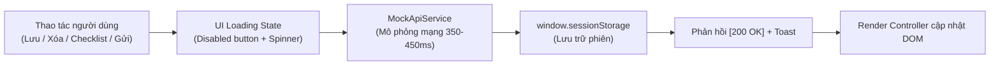

# Cổng Thông Tin Học Bổng Sinh Viên UEH

> **Kiến trúc giải pháp: Zero-Backend Interactive Prototype (Client-side Simulation)**  
> Ứng dụng web trang tĩnh đơn (Single Static Page) tạo trải nghiệm tương tác giống 100% hệ thống Client-Server thực tế, **không cần server backend** và **không tốn chi phí hosting**. Chạy trực tiếp trên trình duyệt hoặc host qua **GitHub Pages**.

---

## 1. Giới thiệu tổng quan

Website giải quyết bài toán phân tán thông tin học bổng tại Đại học Kinh tế TP.HCM (UEH), giúp tân sinh viên và sinh viên các khóa:
- Gom tất cả học bổng của trường và doanh nghiệp về một nơi duy nhất.
- Tự động đối chiếu GPA, điểm rèn luyện (ĐRL), khóa học và nguyện vọng để gợi ý học bổng đủ điều kiện.
- Quản lý hồ sơ cá nhân ("Hồ sơ của tôi"), theo dõi countdown hạn nộp và checklist từng giấy tờ cần làm.
- Cổng tiếp nhận học bổng mới từ doanh nghiệp ở trạng thái chờ duyệt (Pending State).

Tuân thủ đầy đủ 100% các tiêu chí trong tài liệu **`Yeu_cau_KH.txt`**.

---

## 2. Kiến trúc kỹ thuật: Zero-Backend Interactive Prototype

### Các nguyên lý kỹ thuật cốt lõi:
1. **Trang tĩnh đơn độc lập (`index.html`):** 
   - 1 file duy nhất tích hợp HTML5 ngữ nghĩa, CSS hiện đại theo nhận diện thương hiệu UEH (Xanh ngọc lục bảo `#00583d`, Navy `#0b2545`, Vàng hổ phách `#f59e0b`) và toàn bộ Script xử lý logic.
2. **Lưu trữ phiên (Session Persistence):**
   - Sử dụng `window.sessionStorage` để lưu ID học bổng đã lưu, trạng thái tick checklist và danh sách học bổng doanh nghiệp gửi.
   - *Hành vi:* F5/Reload trang **không mất dữ liệu**; đóng tab/trình duyệt sẽ tự động xóa sạch dữ liệu về trạng thái ban đầu. Có nút *"Làm mới dữ liệu"* để reset nhanh khi demo.
3. **Mô phỏng độ trễ mạng (Network Latency):**
   - Tầng `MockApiService` bất đồng bộ (`async/await` + `Promise` + `setTimeout`) trễ 350ms – 450ms trước khi resolve.
4. **Phản hồi giao diện (UI Loading States):**
   - Nút lập tức chuyển sang trạng thái pending (`disabled = true`, spinner xoay, nhãn *"Đang lưu..."*, *"Đang gửi..."*).
   - Toast notification xuất hiện với mã chuẩn RESTful `[200 OK]` hoặc `[201 Created]`.
5. **Cổng học bổng doanh nghiệp (Pending State):**
   - Doanh nghiệp gửi thông tin qua form, dữ liệu lưu vào danh sách chờ Ban Chăm sóc người học duyệt (chưa công bố công khai ngay).

---

## 3. Cách chạy và triển khai

### Cách 1: Chạy trực tiếp trên máy (Không cần cài đặt bất kỳ phần mềm nào)
1. Tải repository về máy.
2. Nhấp đúp chuột trực tiếp vào file **`index.html`** để mở trên bất kỳ trình duyệt nào (Chrome, Edge, Firefox, Safari).

### Cách 2: Triển khai lên GitHub Pages (Miễn phí 100%, 0đ hosting)
1. Đẩy mã nguồn lên repository GitHub của bạn (file `index.html` nằm ở thư mục gốc `root`).
2. Vào **Settings** của repository $\to$ chọn mục **Pages**.
3. Tại phần **Build and deployment**:
   - Source: **Deploy from a branch**
   - Branch: chọn nhánh `main` (hoặc `master`), thư mục chọn `/ (root)`.
4. Bấm **Save**. Sau khoảng 1 phút, trang web sẽ online tại đường dẫn `https://<ten-user>.github.io/<ten-repo>/`.

---

## 4. Bảng đối chiếu 10 mục yêu cầu theo `Yeu_cau_KH.txt`

| Mục yêu cầu | Nội dung trong Yeu_cau_KH.txt | Triển khai thực tế trên Website |
|---|---|---|
| **Mục 3: Danh sách học bổng** | Thẻ gọn gàng, đủ GPA, ĐRL, mức tiền, hạn nộp, tình trạng. Đang nhận hồ sơ lên trước. Phân nhóm so sánh. | Grid responsive, nhãn phân loại UEH / Doanh nghiệp, badge trạng thái động, tabs lọc nhóm. |
| **Mục 4: Ô tìm học bổng** | Nhập GPA, ĐRL, khóa, ngành, nguyện vọng. Tự động kiểm tra điều kiện. | Ô lọc đa tiêu chí ở đầu trang. Gắn nhãn xanh "✅ Đủ điều kiện" hoặc nhãn vàng "⚠️ Chưa đạt: lý do". |
| **Mục 5: Chi tiết học bổng** | Xem toàn bộ chi tiết, nút "Thêm vào Hồ sơ của tôi" có loading state. | Modal popup chi tiết, thông tin điều kiện, hồ sơ, link nguồn gốc dsa.ueh.edu.vn. |
| **Mục 6: Hồ sơ của tôi** | Lưu không mất khi F5, đếm ngược ngày hết hạn, bảng kiểm (checklist) giấy tờ tick/untick. | Quản lý danh sách đã lưu, thanh tiến độ hoàn thành % giấy tờ, cảnh báo đỏ học bổng $\le$ 7 ngày. |
| **Mục 7: Nhắc hạn nộp** | Hiện ngày hết hạn và số ngày còn lại. Cảnh báo gần hạn. | Countdown real-time, tích hợp native Web Notification API của trình duyệt. |
| **Mục 8: Hướng dẫn giấy tờ** | Quy trình chuẩn bị giấy tờ cho từng loại học bổng. | Tab Hướng dẫn 4 bước trực quan + bảng danh mục mẫu giấy tờ chuẩn UEH. |
| **Mục 9: Cổng Doanh nghiệp** | Biểu mẫu gửi học bổng, chuyển về trạng thái chờ duyệt (Pending). | Biểu mẫu gửi học bổng qua Mock API, hiển thị danh sách "Chờ duyệt" của Ban Chăm sóc người học. |
| **Mục 10: Yêu cầu chung** | Cập nhật động theo thời gian, kết quả lọc mang tính tham khảo. | Tự động tính ngày so với ngày hiện tại; disclaimer bản quyền & nguồn DSA UEH rõ ràng. |

---

## 5. Cấu trúc thư mục

- `index.html`: File ứng dụng tĩnh hoàn chỉnh (Single-file solution) phục vụ demo và host GitHub Pages.
- `src/`: Mã nguồn module hóa ban đầu (React/Vite) được lưu trữ làm tài liệu tham khảo kỹ thuật.
- `src/data/scholarships.json`: File dữ liệu 10 học bổng chuẩn UEH.
- `tools/crawl_dsa.py`: Script Python cào dữ liệu tự động từ cổng `dsa.ueh.edu.vn`.
- `Yeu_cau_KH.txt`: Bản đặc tả yêu cầu nghiệm thu của khách hàng đã chốt.
